Figranium provides robust control flow mechanisms to handle dynamic web pages, conditional logic, pagination, and multi-step processes.

## Conditional Execution (If / Else / End)

The **If** block executes a sequence of actions only when a condition is met.

### Structure

Every `if` block must be closed with an `end` block. An optional `else` block can be placed between them.

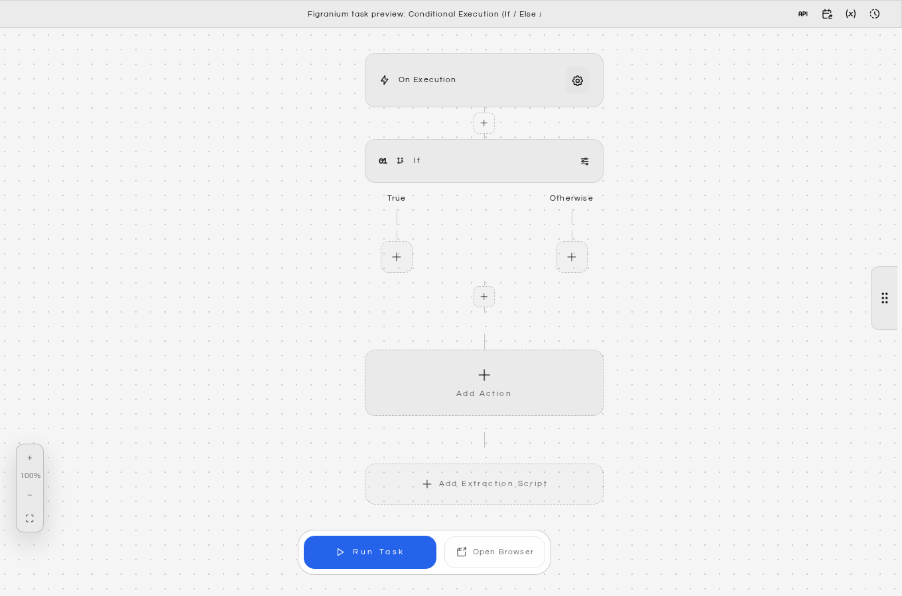

### Condition Types

<Tabs>
  <Tab title="JavaScript Expression">
    A JS expression evaluated in the browser page context. Must return a truthy/falsy value.

    ```js
    exists('.error-message')           // checks if element exists
    text('.status') === 'Success'      // checks element text
    url().includes('/dashboard')       // checks current URL
    {$count} > 5                       // compares a variable
    block.output !== ''                // checks previous block result
    ```

    Available helpers in expressions:

    | Helper | Description |
    | :-- | :-- |
    | `exists(selector)` | Returns `true` if the element is found in the DOM |
    | `text(selector)` | Returns the text content of the first matching element |
    | `url()` | Returns the current page URL |
    | `vars.name` | Access a runtime variable by name |
    | `block.output` | The result of the previous action block |
    | `html` | The full page HTML as a string |
  </Tab>
  <Tab title="Structured Condition">
    A form-based alternative to JS expressions. Define a variable or selector, an operator, and a comparison value.

    | Field | Description |
    | :-- | :-- |
    | `conditionVarType` | `string`, `number`, or `boolean` |
    | `conditionVar` | Variable name or `{$varName}` reference |
    | `conditionOp` | Comparison operator (see table below) |
    | `conditionValue` | The value to compare against |

    **Operators by type:**

    | Type | Operators |
    | :-- | :-- |
    | String | `equals`, `not_equals`, `contains`, `starts_with`, `ends_with`, `matches` (regex) |
    | Number | `equals`, `not_equals`, `gt`, `gte`, `lt`, `lte` |
    | Boolean | `is_true`, `is_false` |
    | Selector | `exists`, `not_exists` |
  </Tab>
  <Tab title="Selector Condition">
    Set `conditionVarType` to `selector` to branch on whether an element is currently present in the DOM. Figranium runs `document.querySelector(selector)` against the live page each time the condition is evaluated.

    | Field | Description |
    | :-- | :-- |
    | `conditionVarType` | `selector` |
    | `selector` | CSS selector to check against the current page. Supports template variables like `{$productId}`. |
    | `conditionOp` | `exists` (element is present) or `not_exists` (element is absent). |

    Use the target icon next to the selector input to pick the element with the [Highlight Tool](/highlight-tool) instead of typing the selector by hand.

    **Example: Skip a modal only when it's showing**

    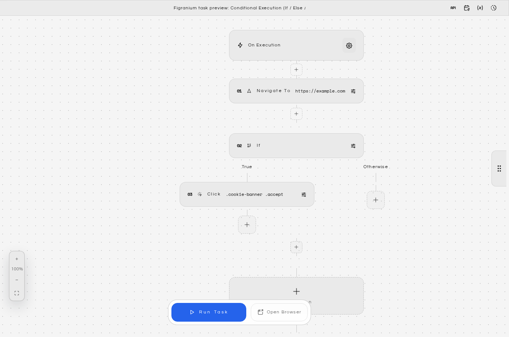

    **Example: Paginate while a "next" button remains**

    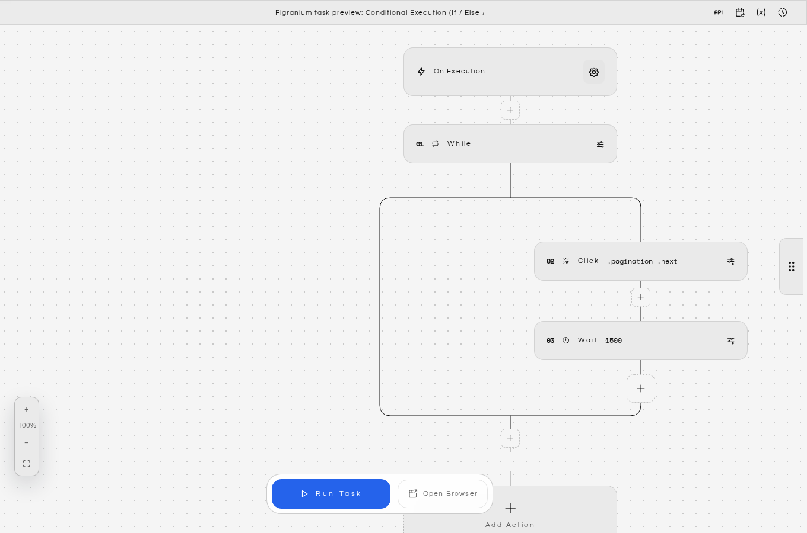
  </Tab>
</Tabs>

### Example: Login Check

Check whether the user is already logged in, and skip the login form if so:

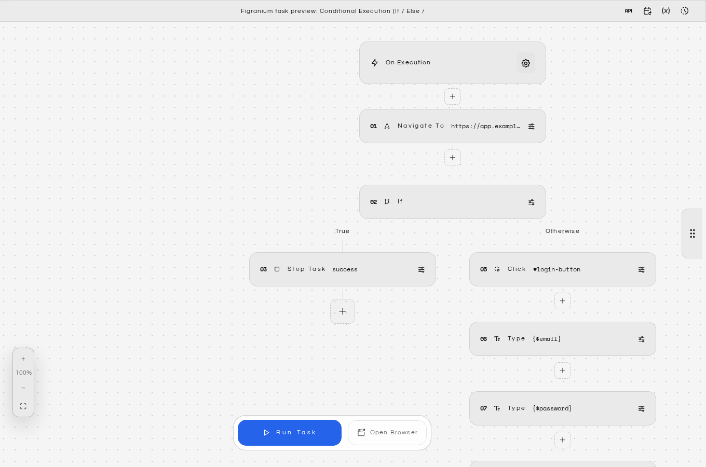

### Nested Conditions

You can nest `if` blocks inside each other. Each nested block requires its own `end`:

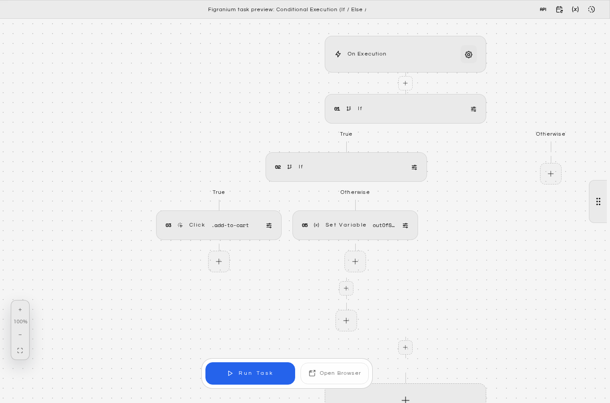

---

## Loop Types

<AccordionGroup>
  <Accordion title="While Loop" icon="rotate">
    Executes a block of actions repeatedly as long as the condition remains `true`.

    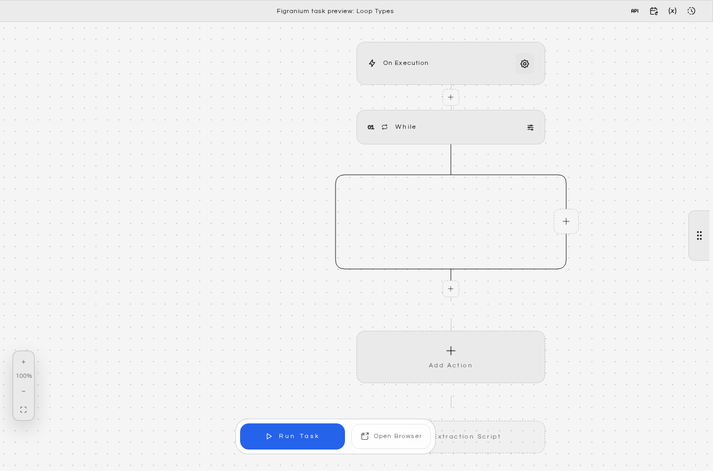

    **Common use cases:**

    - **Pagination**: Click "next page" until there are no more pages.
    - **Polling**: Wait for a specific element or state to appear.
    - **Retry logic**: Re-attempt an action until it succeeds.

    **Example: Scraping paginated results**

    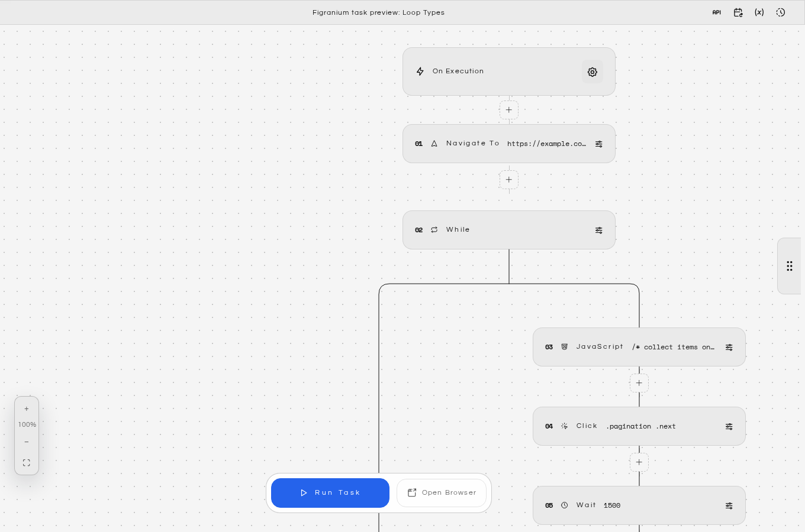

    <Warning>
      Prevent infinite loops by tracking a counter variable:

      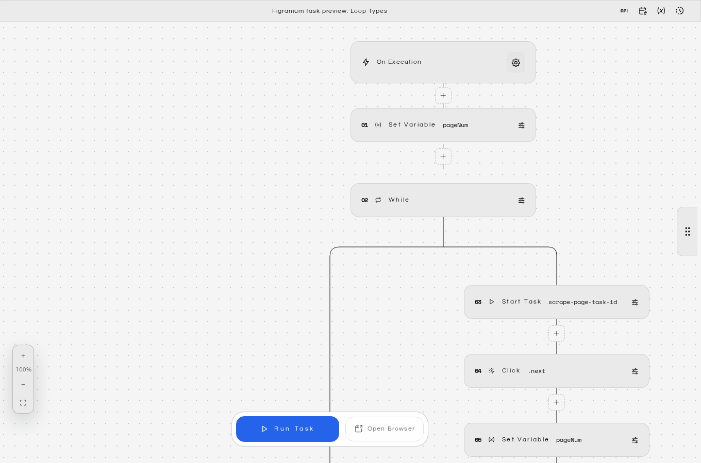
    </Warning>
  </Accordion>

  <Accordion title="Foreach Loop" icon="list">
    Iterates over all elements matching a CSS selector, executing the block once per element.

    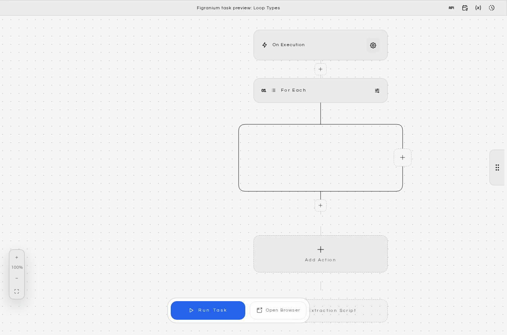

    **Loop variables available inside the block:**

    | Variable | Description |
    | :-- | :-- |
    | `loop.index` | Zero-based index of the current iteration |
    | `loop.text` | The full text content of the current element |
    | `loop.html` | The full HTML of the current element |
    | `loop.item` | Reference to the current element (for click/interact without a selector) |

    **Example: Clicking each item in a list**

    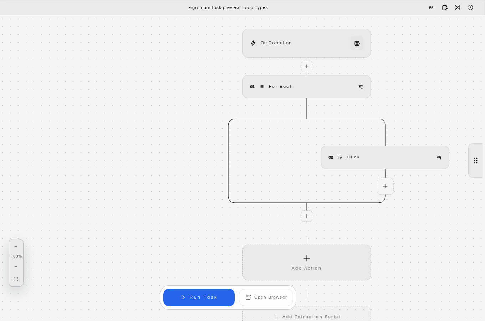

    **Example: Extracting data from a table**

    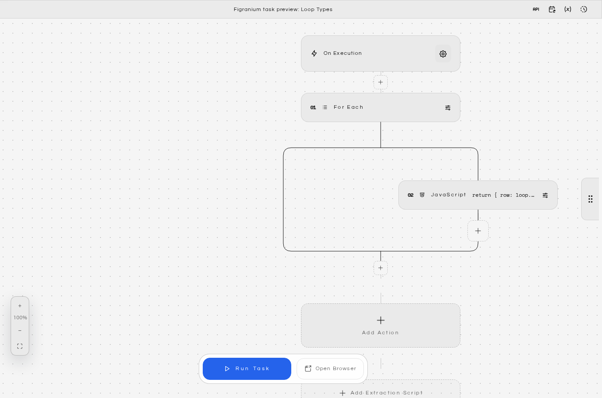
  </Accordion>

  <Accordion title="Repeat N Times" icon="repeat">
    Executes a block a fixed number of times regardless of any condition.

    

    The `loop.index` variable is available inside `repeat` blocks (zero-based).

    **Example: Submit a form 3 times**

    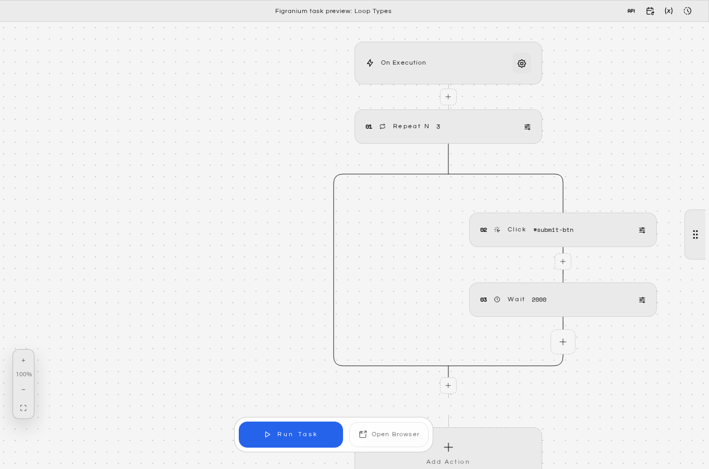
  </Accordion>
</AccordionGroup>

---

## Error Handling (On Error)

The **On Error** block acts like a `try/catch`. If any action in the main flow throws an error (timeout, element not found, network failure), execution jumps to the error handler block.


**Example: Handle a CAPTCHA popup**

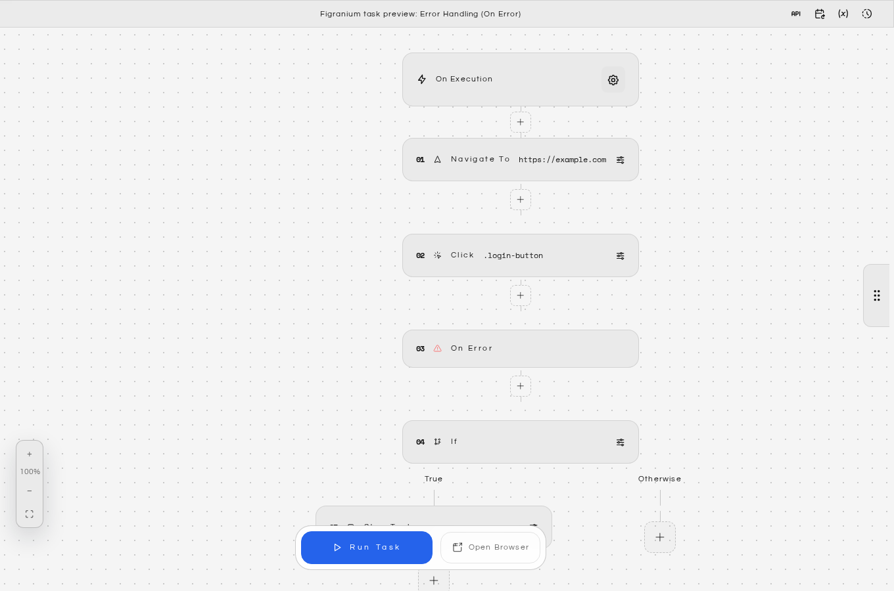

**Example: Dismiss a cookie banner that may or may not appear**

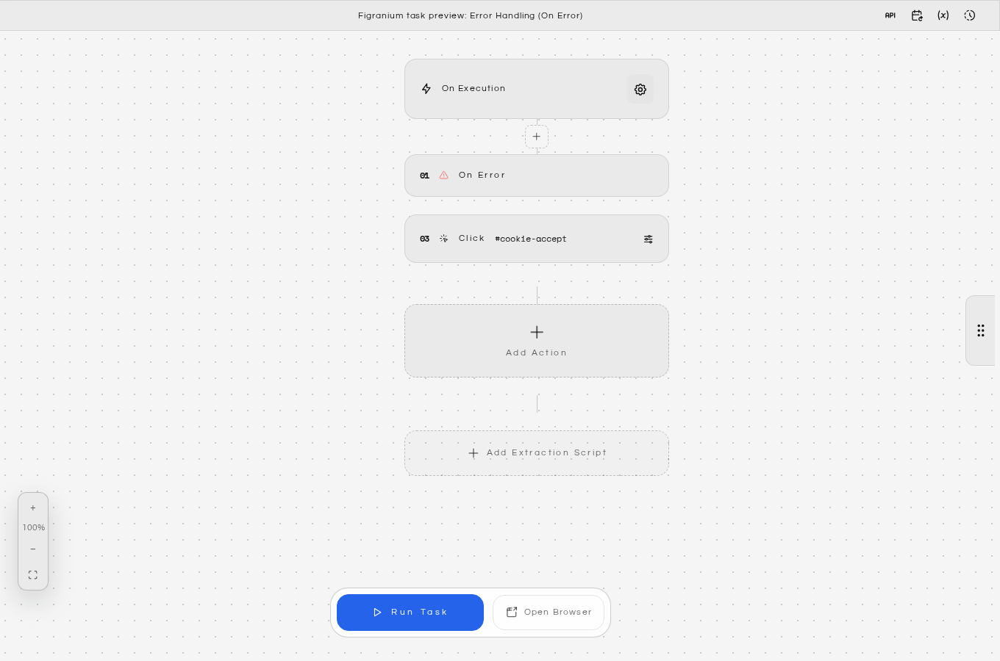

Placing an empty `on_error`/`end` block before an optional action effectively makes that action non-fatal.

See [Error Handling](/error-handling) for a deeper guide on retry patterns and resilient task design.

---

## Stop Task

Immediately terminates the current task execution with a given status.

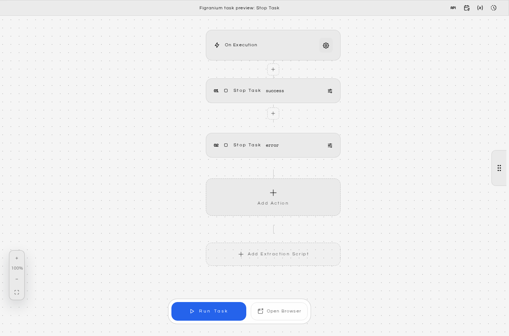

Use `stop` inside conditionals to short-circuit execution when a goal is already met or when an unrecoverable state is detected.

<CardGroup cols={2}>
  <Card title="Error Handling" icon="book" href="/error-handling">
    Learn retry patterns and resilient task design.
  </Card>

  <Card title="Variables" icon="code" href="/variables">
    Use variables to build dynamic conditions and counters.
  </Card>

  <Card title="JavaScript Execution" icon="arrow-right" href="/javascript-execution">
    Write custom logic for complex conditions.
  </Card>

  <Card title="Modular Workflows" icon="cube" href="/modular-workflows">
    Break complex flows into reusable sub-tasks.
  </Card>
</CardGroup>