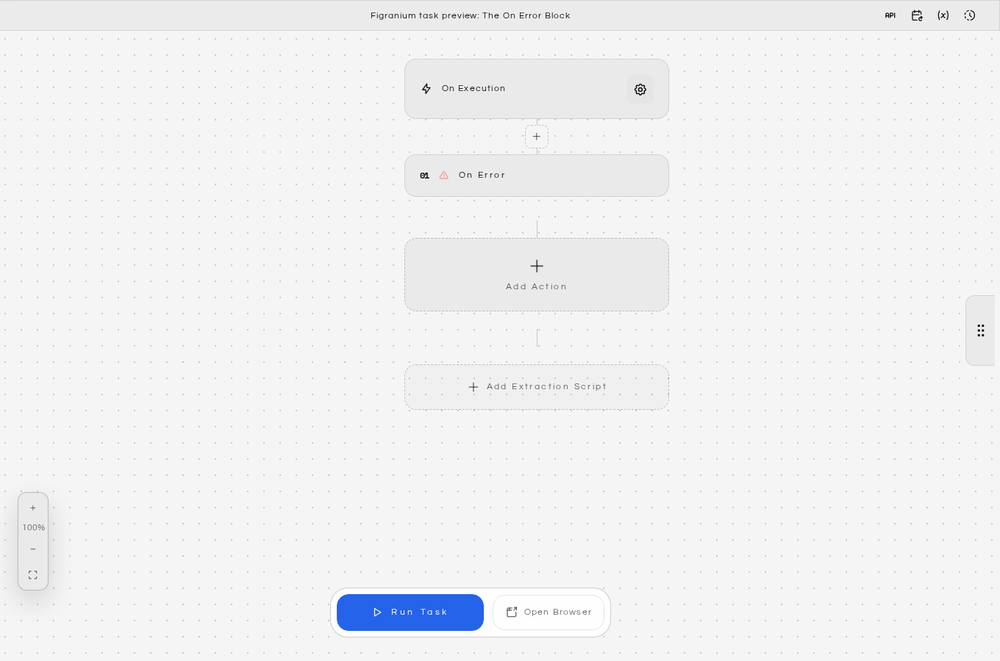
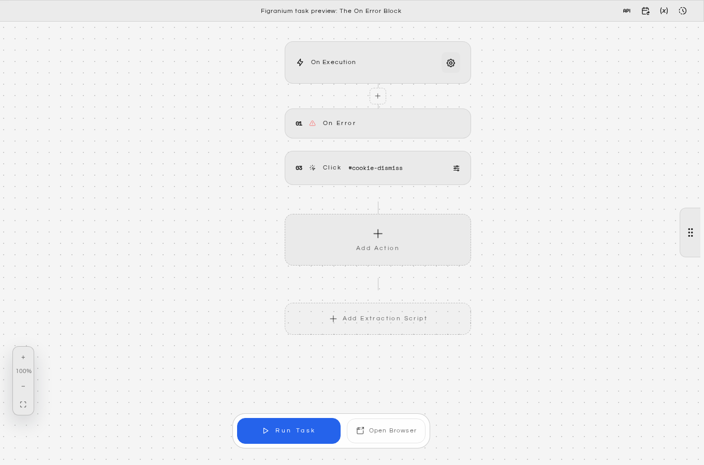
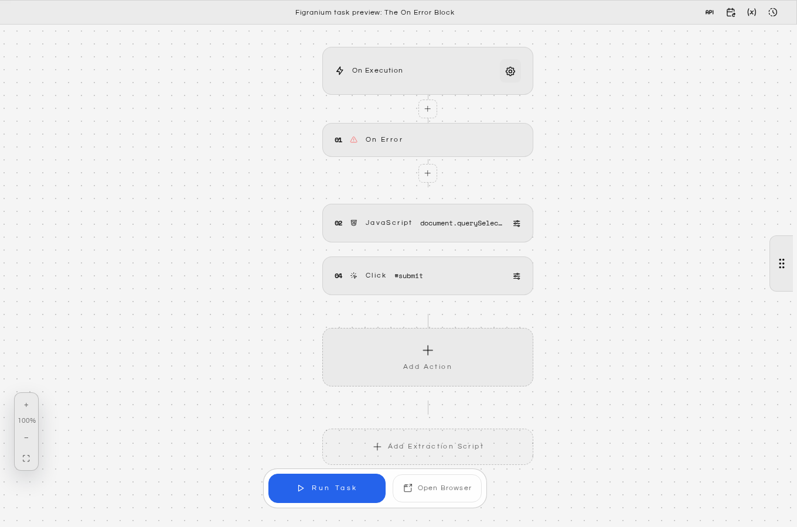
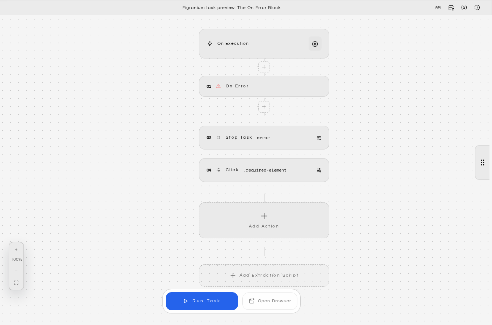
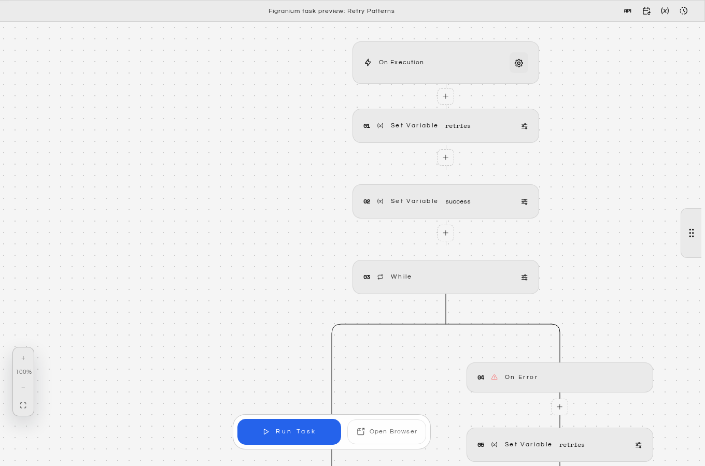
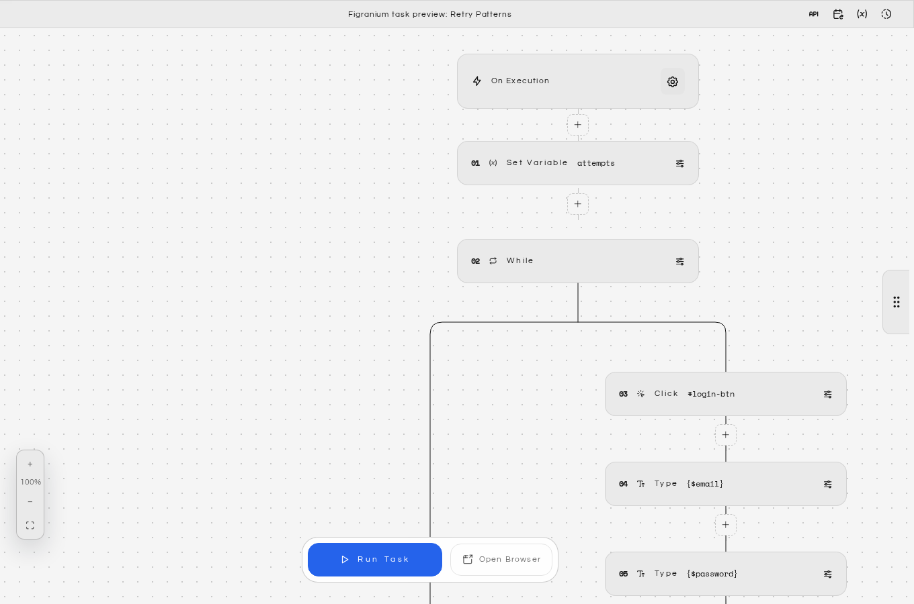
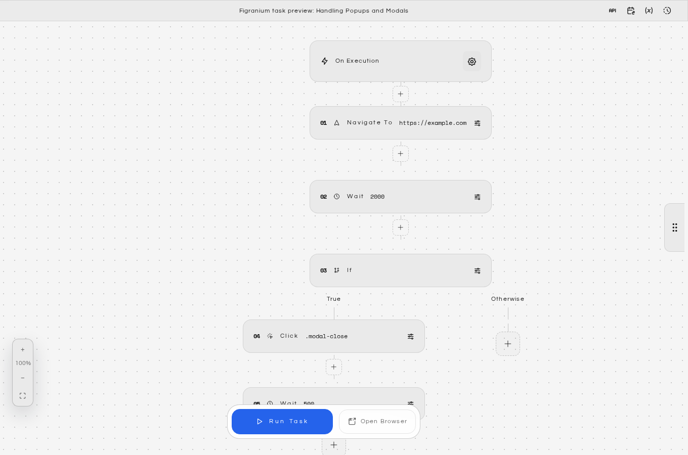
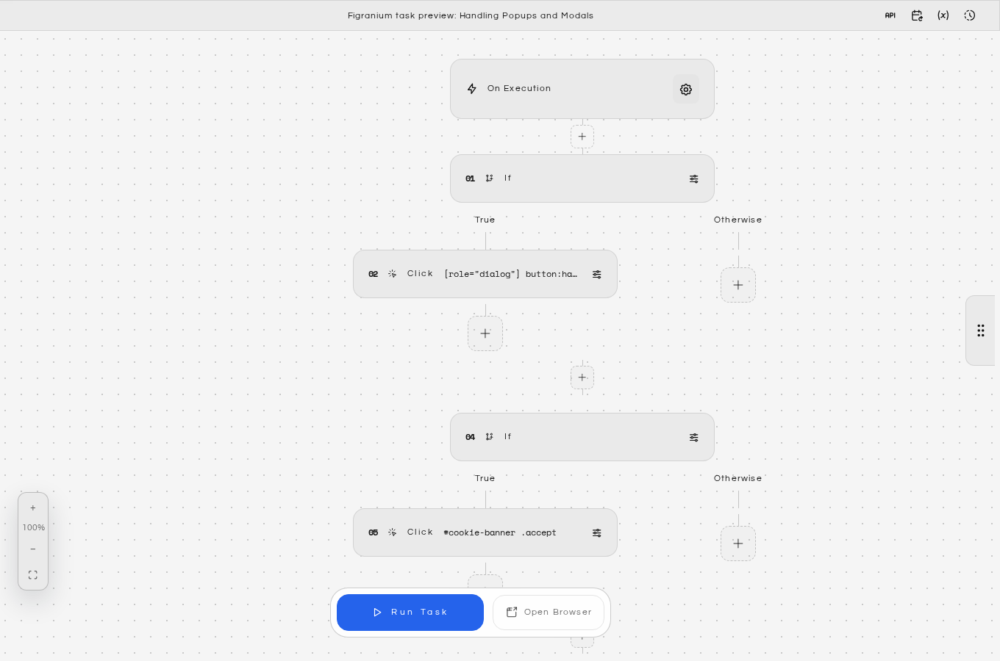
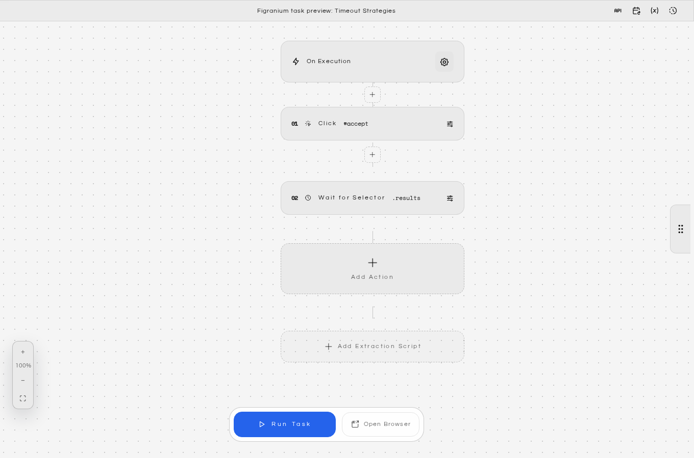
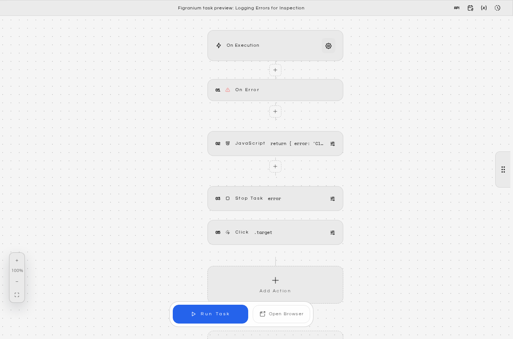

Figranium provides several mechanisms to make your automation tasks resilient to failures, from optional actions to retry loops and fallback sub-tasks.

## Why Tasks Fail

Common failure modes in browser automation:

<CardGroup cols={2}>
  <Card title="Timeouts" icon="time-duration-0">
    An element takes longer than expected to appear.
  </Card>

  <Card title="Popups & Modals" icon="window-maximize">
    A popup or modal interrupts the expected flow.
  </Card>

  <Card title="Network Failures" icon="wifi-off">
    A network request fails or times out.
  </Card>

  <Card title="Stale Selectors" icon="code">
    A selector becomes stale after a navigation.
  </Card>

  <Card title="CAPTCHA" icon="shield">
    A CAPTCHA is triggered.
  </Card>

  <Card title="Dynamic Content" icon="stroke-dynamic">
    Dynamic content changes the page structure.
  </Card>
</CardGroup>

A well-designed task anticipates these failures and handles them gracefully.

---

## The On Error Block

The On Error block is Figranium's primary error handling mechanism. It works like a `try/catch`: if any action in the main flow raises an error, execution jumps to the On Error block.

The On Error / End pair should be placed in the task to catch errors from preceding actions. Any error thrown by an action before the On Error block is caught.

<AccordionGroup>
  <Accordion title="Making an Action Optional" icon="circle-check">
    The simplest use: place an empty On Error / End block to absorb errors from an action that may or may not exist:

    
  </Accordion>

  <Accordion title="Fallback Action" icon="rotate">
    Perform a fallback action when the primary approach fails:

    
  </Accordion>

  <Accordion title="Stop on Error with a Reason" icon="player-stop">
    Log the failure and stop the task cleanly:

    
  </Accordion>
</AccordionGroup>

---

## Retry Patterns

### Retry with a Counter Variable

Use a While loop combined with a counter to retry a failing action up to N times:

This retries up to 3 times with a 2-second pause between attempts, then continues if any attempt succeeds.

### Retry a Login

---

## Handling Popups and Modals

Popups that appear unpredictably are a common cause of task failures. Handle them proactively.

### Check and Dismiss Before Proceeding

### Dismiss Any Popup on Every Page

Use a sub-task triggered via a Start Task block to handle common popups at the beginning of every task:

<Tip>
  See [Modular Workflows](/modular-workflows) for more on reusing sub-tasks across multiple parent tasks.
</Tip>

---

## Timeout Strategies

Each action block can have its own `timeout` (in milliseconds). Use shorter timeouts for elements that should appear quickly, and longer ones for slow-loading content.

Use an On Error block around short-timeout actions to make them non-fatal when the element doesn't appear.

---

## Logging Errors for Inspection

Use a JavaScript block inside an On Error branch to log diagnostic information to the execution output:

The returned object appears in the execution detail view, giving you context about what the page looked like when the failure occurred.

---

## Output Provider Error Handling

When using [Output Providers](/output-providers), you can control what happens if the data push to an external service fails:

- **`onError: "ignore"`** (default): The execution is marked as successful even if the push fails.
- **`onError: "fail"`**: The execution is marked as failed if the push fails.

Choose `fail` when data delivery is critical and you want alerts on push failures.

<Warning>
  Always include a termination condition in retry loops. An unbounded While loop with no exit condition will run until the task times out.
</Warning>

<Tip>
  Combine On Error blocks with [JavaScript Execution](/javascript-execution) to capture rich diagnostic data when failures occur.
</Tip>
