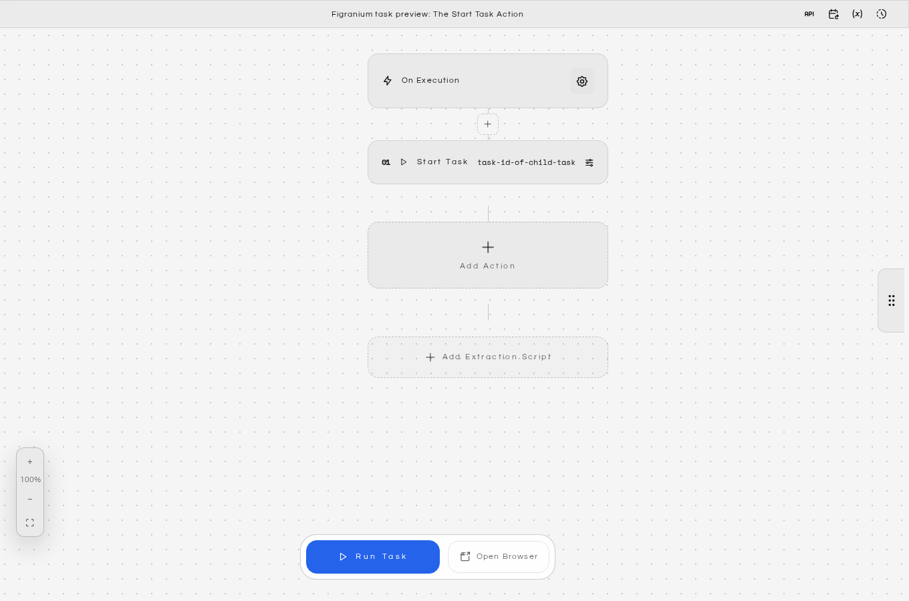
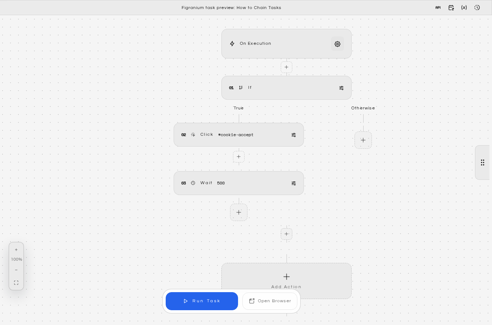
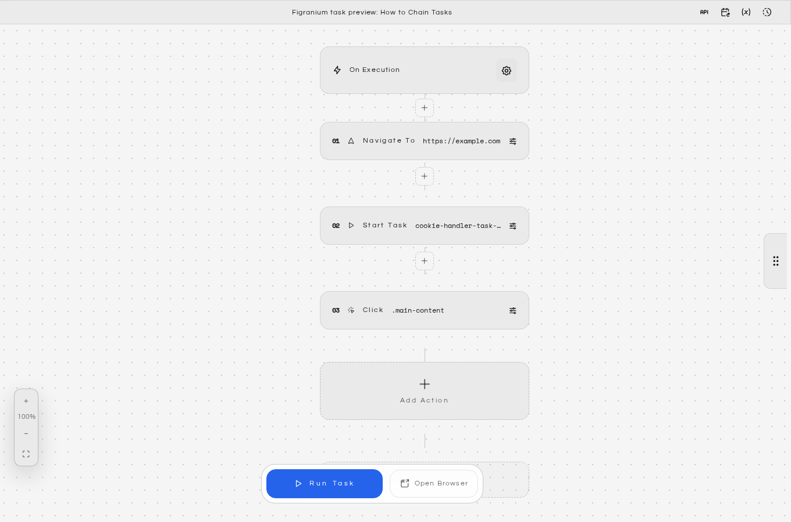
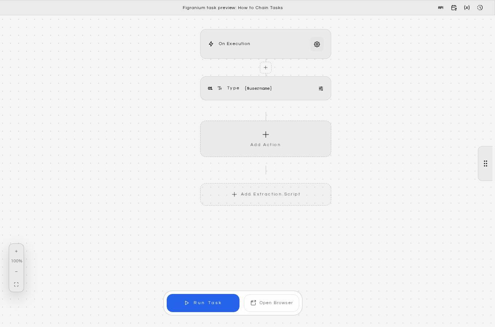
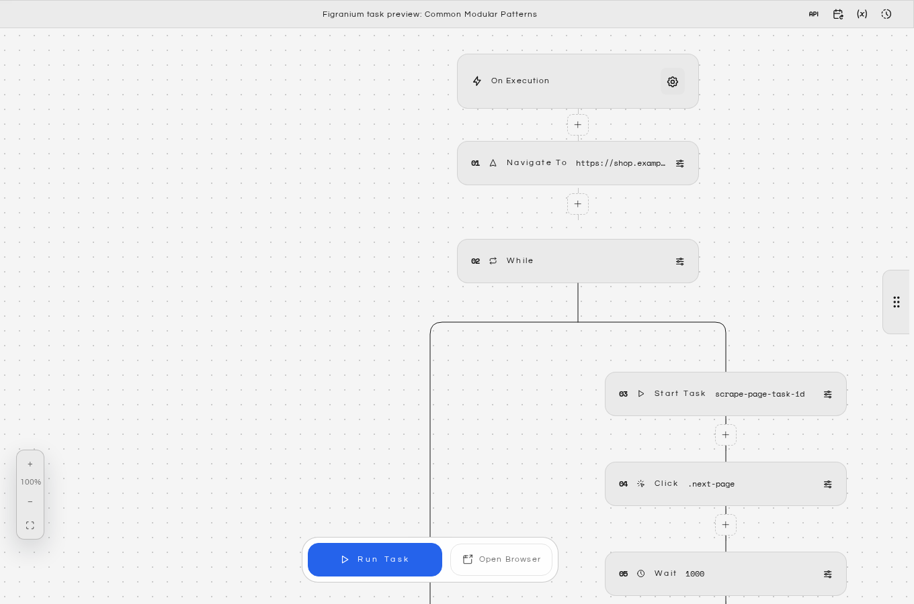
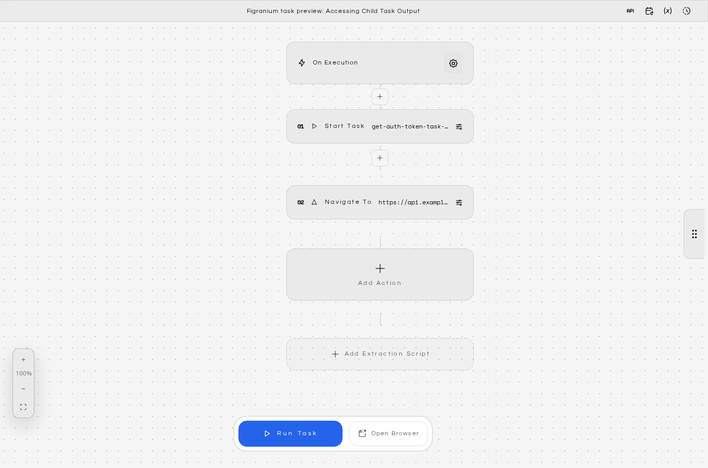
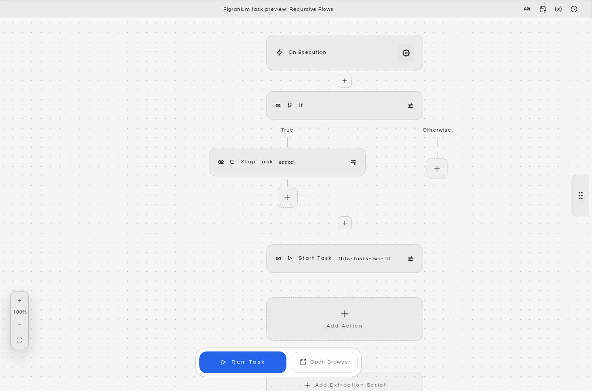
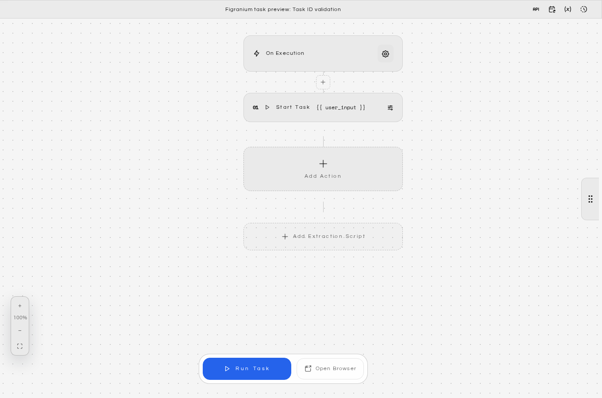

Figranium supports **Modular Workflows**, allowing you to break complex automations into smaller, reusable tasks and chain them together using the **Start Task** block.

## Why Modular Workflows?

As automations grow, a single monolithic task becomes hard to maintain. Modular workflows let you:

<CardGroup cols={2}>
  <Card title="Reuse" icon="rotate">
    Common sub-flows (login, cookie consent, pagination) across many tasks.
  </Card>

  <Card title="Debug" icon="bug-off">
    Individual components in isolation without re-running the entire workflow.
  </Card>

  <Card title="Organize" icon="sitemap">
    Large automation suites into readable, focused building blocks.
  </Card>

  <Card title="Share" icon="share-3">
    Components with your team as standalone, documented tasks.
  </Card>
</CardGroup>

## The Start Task Action

The Start Task action triggers another task by its ID, running it as a sub-task within the current execution context.

**Key behaviors:**

- The child task runs to completion before the parent continues.
- Variables from the parent task are passed down to the child task automatically.
- The child task's `block.output` (extraction result) is available back in the parent as `block.output` after the Start Task block.
- If the child task fails, the parent task's error handling applies.

---

## How to Chain Tasks

<Steps>
  <Step title="Create the Child Task">
    Build a standalone task that handles a specific sub-flow. For example, a "Handle Cookie Banner" task:

    

    Note its task ID from the dashboard URL.
  </Step>
  <Step title="Add `start` to Your Main Task">
    In your main task, add a **Start Task** block where you want the child task to run:

    
  </Step>
  <Step title="Pass Variables to Child Tasks">
    Variables defined in the parent task are automatically available in the child task using the same `{$varName}` syntax. There is no special configuration needed.

    
  </Step>
</Steps>

---

## Common Modular Patterns

### Pattern 1: Shared Login Task

Create a single "Login" task and call it at the start of all tasks that require authentication:

### Pattern 2: Paginated Scraping

Break pagination into a loop calling a "Scrape One Page" sub-task:

### Pattern 3: Error Recovery

Use an **On Error** block to trigger a recovery sub-task when something goes wrong:

---

## Accessing Child Task Output

After a Start Task block, the child task's extraction result is available in `block.output`:

---

## Recursive Flows

It is technically possible to create recursive chains (Task A starts Task B, which starts Task A). This can be useful for retry loops or indefinite monitoring tasks.

**Always include a termination condition to prevent infinite loops:**

---

## Finding Task IDs

You can find a task's ID in several ways:

1. **Dashboard URL**: When you open a task, the URL contains the task ID (e.g., `/editor/task_abc123`).
3. **Export**: The exported JSON file includes the task ID at the top level.

---

## Task ID validation

The Start Task block sanitizes the task ID before issuing the internal API call. Only alphanumeric characters, underscores (`_`), and hyphens (`-`) are preserved; any other character, including path separators, query strings, and whitespace, is stripped out.

If sanitization removes every character (for example, when a template variable resolves to `../../api/clear-cookies?` or any other non-conforming string), the action fails fast with `Invalid task id.` and no request is made. This prevents a crafted variable value from being used to probe other internal endpoints through the Start Task block.

When `user_input` resolves to `task_abc123`, the action runs normally. When it resolves to `../../api/clear-cookies?`, the action errors with `Invalid task id.` and the parent task continues with that step marked failed.

<Tip>
  If you build task IDs dynamically with variables, make sure the upstream source can only produce values matching `[A-Za-z0-9_-]+`. Otherwise the sanitizer may silently shorten the ID before the call.
</Tip>

<CardGroup cols={2}>
  <Card title="Variables" icon="variable" href="/variables">
    Pass dynamic data between parent and child tasks.
  </Card>

  <Card title="Control Flow" icon="sitemap" href="/control-flow">
    Build loops and conditionals around sub-task calls.
  </Card>

  <Card title="Error Handling" icon="shield" href="/error-handling">
    Make your modular workflows resilient to failures.
  </Card>

  <Card title="Task Scheduling" icon="clock" href="/task-scheduling">
    Schedule recurring workflows that chain multiple tasks.
  </Card>
</CardGroup>
