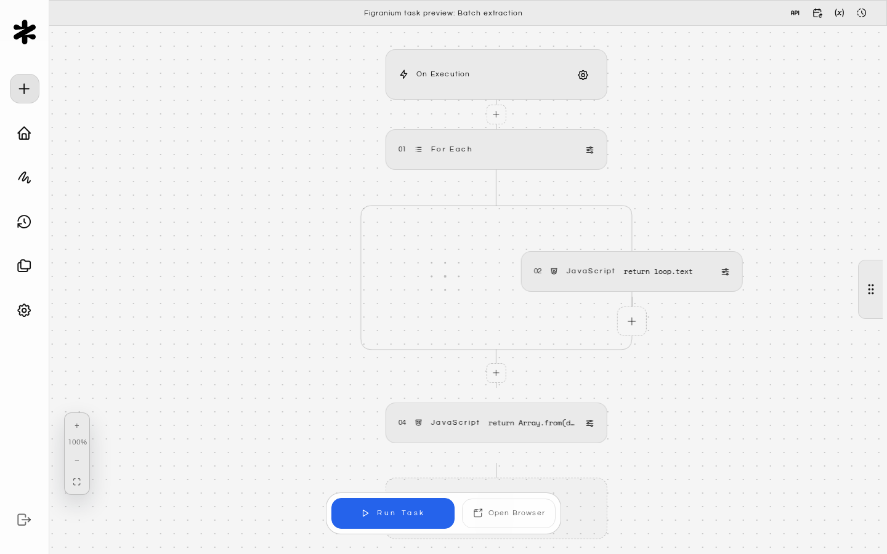

Figranium is a self-hosted, block-based browser automation platform. You build visual tasks in the editor, then execute them through the REST API, MCP server, or SDK. All task definitions, browser state, and execution data stay on your own infrastructure.

<CardGroup cols={2}>
  <Card title="Quickstart" icon="rocket" href="/quickstart">
    Get Figranium running locally in minutes.
  </Card>

  <Card title="Docker Compose" icon="brand-docker" href="/docker-compose">
    Deploy with the official Docker Compose template.
  </Card>

  <Card title="Action Blocks" icon="cube" href="/action-blocks">
    Browse the blocks that make up browser workflows.
  </Card>

  <Card title="REST API" icon="code" href="/rest-api">
    Trigger tasks and fetch results from any application.
  </Card>

  <Card title="MCP Server" icon="robot" href="/mcp-integration">
    Expose tasks to AI clients via the Model Context Protocol.
  </Card>

  <Card title="Templates Hub" icon="layout-grid" href="/community-presets">
    Import community presets and share your own.
  </Card>
</CardGroup>

## What you can build

- **Data extraction** — scrape structured JSON or CSV from websites with pagination and dynamic content.
- **Form automation** — fill forms, upload files, and interact with single-page apps.
- **End-to-end testing** — run browser tests with visual feedback and deterministic execution.
- **Scheduled jobs** — trigger recurring workflows with built-in cron-style scheduling.

## Key principles

- **Block-first** — complex logic breaks into simple, composable blocks such as Click, Type, Wait, and If/Else.
- **Self-hosted** — task definitions, cookies, local storage, and logs live on your machine or server.
- **Deterministic** — the Figranite engine runs tasks in a predictable, ordered sequence with controlled flow logic.
- **Hybrid execution** — debug interactively in the editor, trigger via REST API, or run headless from the CLI. The same task works across every entry point.

## Where next

- [Why Figranium](/why-figranium) — how it compares to code-first frameworks, SaaS platforms, and low-code tools.
- [Architecture](/architecture) — the frontend, backend, and browser engine layers.
- [Configuration](/configuration) — environment variables, database options, and deployment settings.
