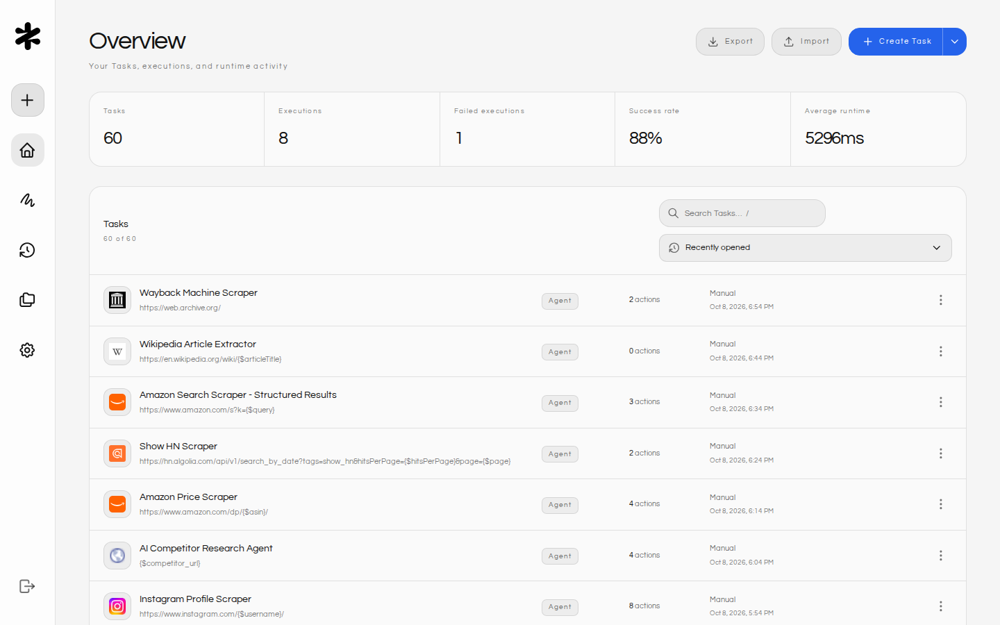
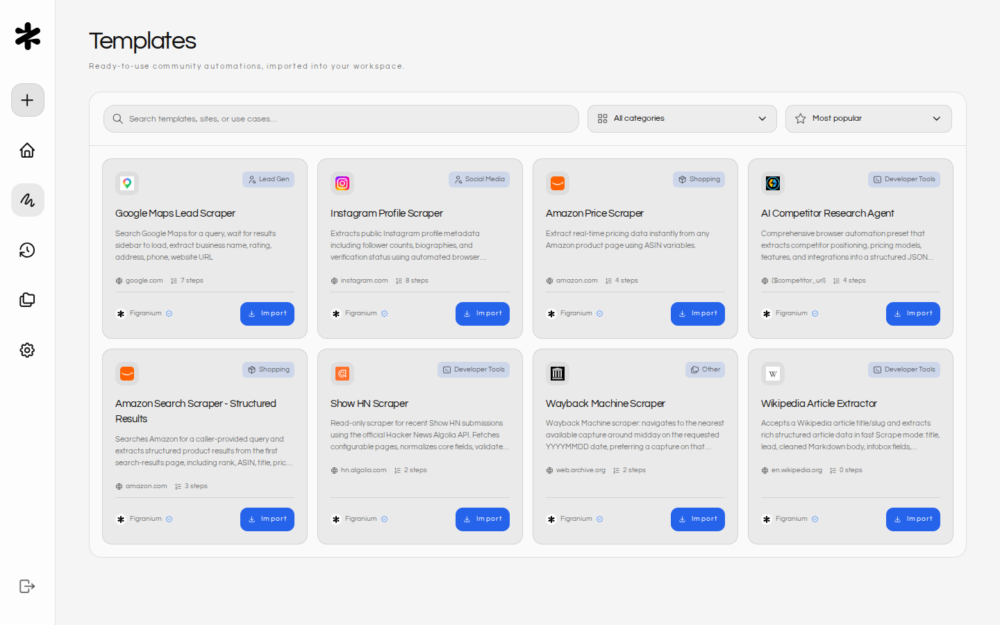
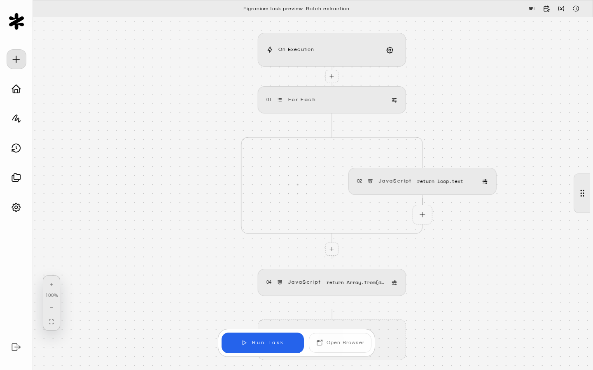
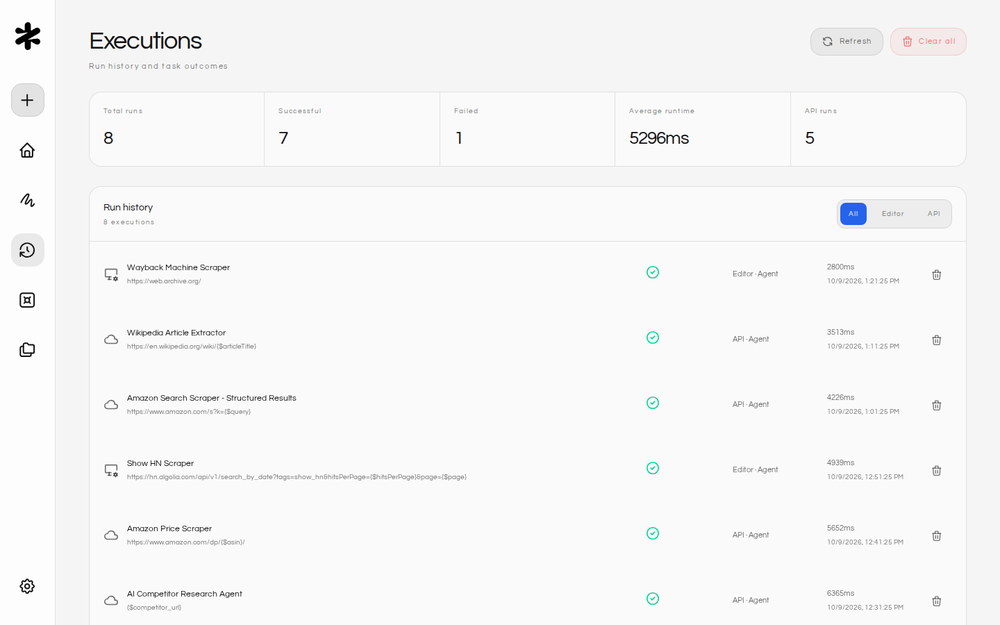
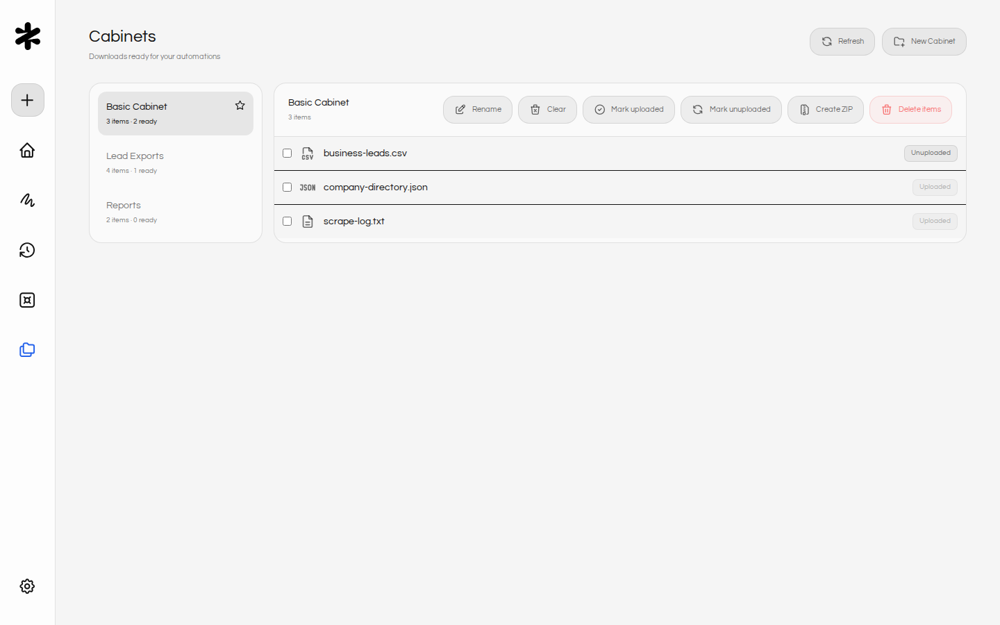
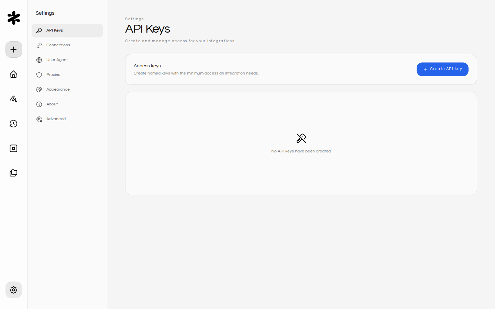

Figranium's user interface is designed for simplicity and power. It consists of six main sections: Dashboard, Templates, Editor, Executions, Cabinets, and Settings.

<CardGroup cols={2}>
  <Card title="Dashboard" icon="home" href="/dashboard">
    View, create, import, and manage all your automation tasks in a searchable grid.
  </Card>

  <Card title="Templates" icon="sketching" href="/community-presets">
    Browse community automations and import them into your workspace as new tasks.
  </Card>

  <Card title="Executions" icon="history" href="/executions">
    Review a chronological log of every task run with status, source, duration, screenshots, and recordings.
  </Card>

  <Card title="Cabinets" icon="folder" href="/cabinets">
    Manage durable download queues, upload state, archives, and files produced by tasks.
  </Card>

  <Card title="Settings" icon="settings" href="/settings">
    Configure API keys, user agents, proxies, appearance, retention, and maintenance.
  </Card>
</CardGroup>

## Dashboard

- **Overview**: View all your saved automation tasks in a grid layout.
- **Actions**:
  - **Create Task**: Click **Create Task** to start a blank automation flow. Open the arrow menu next to it to choose **Start from scratch** (a blank task) or **Create from a template** (opens [Templates](#templates)).
  - **Import/Export**: Use the `Import` and `Export` buttons to move tasks between environments (JSON format).
  - **Edit**: Click any task card to open the editor, or use the **Edit Task** button at the bottom of the card.
  - **Delete**: Remove tasks permanently.
- **Filter tasks**: When you have one or more tasks, a search bar appears in the dashboard header. Type to filter tasks by name or URL in real time. A clear button appears inside the field when text is entered, letting you reset the filter with one click. If no tasks match, a "No matching tasks" message is displayed along with a **Clear Filter** action.
- **Copy URL**: Hover over any task card (or tab into it) to reveal a **Copy** button that copies the target URL to your clipboard — handy for sharing or pasting into other tools without opening the editor.
- **Status Indicators**: Shows the task mode (Agent, Scraper) and target URL. Each card displays the target site's favicon in full color, so you can identify tasks at a glance. Hover over a task name to see the full title in a tooltip — useful when names are truncated on smaller screens.
- **Featured templates**: When you have no tasks yet, the dashboard shows **Start with a popular template** with the three most popular templates and an option to start from scratch.
- **Keyboard navigation**: All dashboard buttons support keyboard navigation with visible focus indicators. Hover over any button to see a tooltip describing its action and keyboard shortcut (e.g., "Create new task (Alt \+ N)"). Press `/` from anywhere on the dashboard to focus the search bar instantly.

## Templates

The **Templates** screen (`/templates`) lists ready-to-use community automations from the official Figranium Templates Hub.

- **Find templates**: Search by template, site, or use case, filter by category, and sort by **Most popular**, **Newest**, or **Name**. Click **Load more templates** to see more results.
- **Preview**: Click a card to open a preview with the template's README and expected output. Each card shows its creator and whether the creator is verified.
- **Import**: Click **Import** on a card or in the preview to add the template as a new task and open it in the editor.

See [Templates](/community-presets) for details.

## Editor

The core of Figranium. This screen features an infinite canvas spatial editor for building your automation flows:

- **Infinite Canvas (Configuration)**:
  - **Task Name**: Rename your task.
  - **Task Description**: Add an optional description in the Task Settings panel (always visible above the tab bar). The description renders on the canvas inside the trigger card and is included in API responses, giving AI agents and collaborators context about what the task does without opening the full editor.
  - **Mode Selector**: Switch between `Agent` (a custom, deterministic action sequence you build from blocks, including control-flow logic like `If`, `While`, and `Loop`) and `Scraper` (simple extraction). Agent Mode is not autonomous AI decision making — every step and branch is defined by you and replays the same way on every run.
  - **View Mode**: Toggle between `Visual` (blocks), `JSON` (raw code), and `API` (integration details).
  - **Trigger via API panel**: The API tab of Task Settings shows the task's complete, ready-to-use endpoint URL (for example, `https://your-figranium.example.com/api/tasks/task_1/api`) with a `POST` method badge next to it. The URL includes your instance origin, so the copy button gives you a value you can paste straight into external tools like Clay or n8n without prefixing the host yourself. The panel also shows a copyable example payload for overriding task variables. See [REST API Reference](/rest-api#tasks) for the full endpoint documentation.
  - **Target URL**: The starting point for the automation.
  - **Spatial Actions**: Add, arrange, and connect action blocks (Click, Type, Wait, etc.) directly on the zoomable, pannable canvas.
    - **Opening block settings**: Double-click any action block to open its settings modal. This lets you configure the block's parameters (selector, value, timeout, etc.) without accidentally triggering other interactions while dragging or rearranging blocks.
    - **Changing block type**: Click the type label on a block (e.g., "CLICK", "TYPE") to open the Action Palette for that block, letting you switch it to a different action type. If you click the label a second time quickly, the block settings modal opens instead.
  - **Sticky Notes**: Right-click the canvas and select **Add sticky note** to place a free-form text note anywhere on the canvas. Use sticky notes to annotate your workflow, leave reminders, or document complex logic for collaborators.
    - **Colors**: Click a color swatch in the note header to change the note color (default, yellow, pink, green, or purple).
    - **Edit**: Click the edit button in the note header to modify the text. Sticky notes grow automatically as their content gets longer, so long guidance is not clipped into a fixed-height card.
    - **Copy**: Click the copy button to copy the note content to your clipboard.
    - **Delete**: Click the delete button to remove the note.
    - **Keyboard navigation**: All sticky note actions are fully keyboard-accessible. Tab into a note to reveal the action buttons, and use visible focus indicators to navigate between controls.
  - **Action Palette**: A floating overlay to quickly find and add new action blocks anywhere on the canvas. The palette opens with the search field focused so you can start typing immediately. As you type, blocks are filtered in real time.
    - **Search**: Type to filter available actions (e.g., "click", "if", "while"). A clear button appears inside the search field when text is entered, letting you reset the filter with one click.
    - **Keyboard navigation**: Use the arrow keys to move between actions in the grid — `Up`/`Down` move between rows and `Left`/`Right` move within a row. Press `Enter` to insert the highlighted action. Press `Escape` to clear the current search query; if the search field is already empty, pressing `Escape` closes the palette. The active item is visually highlighted so you always know which action is selected. All interactive elements have visible focus indicators for keyboard and screen-reader users.
    - **Auto-open configuration modal**: After you insert a configurable action from the palette, Figranium automatically opens that block's settings modal so you can fill in its selector, value, or other parameters straight away — no extra double-click required. Structural blocks that take no configuration (Else, End, On Error, and Do Nothing) skip this step and are added silently.
    - **Shortcut hints**: Buttons throughout the editor display their keyboard shortcut in a tooltip when you hover or focus them (e.g., "Add action (Ctrl \+ K)" or "Run Task (Ctrl \+ Enter)").
  - **Variables**: Define dynamic parameters (e.g., `{$query}`) for reuse. The editor header includes a Variables shortcut that opens the Variables tab in Task Settings directly.
  - **On Execution**: New tasks include the On Execution configuration panel by default. Its task-level wait defaults to `0` seconds unless you explicitly set another value.
  - **Page Translation**: Browser-backed tasks can opt in to translating the rendered page before actions and extraction run. Translation is disabled by default and is reapplied after navigation in Agent and Headful sessions. Scrape mode remains HTTP-only and does not run page translation. See [Page Translation](/page-translation).
  - **Extraction Script**: Write JavaScript to parse the page content after execution.
  - **Settings**: Configure stealth, recording, proxy rotation, and viewports.
- **Schedule Tab**:
  - Configure automated task execution using visual presets (interval, daily, weekly, monthly) or cron expressions.
  - View next/last run status and duration.
- **Keyboard shortcuts**:
  - Press `Cmd/Ctrl + Enter` to run the current task immediately. The results drawer opens automatically so you can watch live output.
  - Press `Escape` to dismiss the topmost overlay. Figranium evaluates overlays in the following priority order and closes the first one that is open:
    1. Version preview
    2. Action Palette
    3. Cabinet (side panel)
    4. Context menu
    5. Results drawer
  - Press `Cmd/Ctrl + K` to open the Action Palette.
- **Results Drawer**:
  - A slide-out panel that contains real-time feedback and results.
  - **Live Logs**: Real-time feedback from the runner.
  - **Screenshot Preview**: See the final state of the browser.
  - **Extracted Data**: View the JSON/CSV output. The table preview displays up to **200 rows** for fast rendering. Use **Export** or **Copy Full** to access the complete dataset.
  - **Activity Log**: A scrollable, timestamped log of every action taken during the automation run. Use the **Copy** button in the log header to copy the full log to your clipboard — useful for debugging or sharing run details. The button shows brief "Copied" confirmation feedback after you click it.
  - **Captures**: When viewing captures from the results drawer, press `Escape` to close the captures overlay.
  - **History**: Access previous versions of the task (if saved).

<Tip>
  Press `Cmd/Ctrl + K` anywhere in the editor to open the Action Palette and start adding blocks without touching the mouse.
</Tip>

## Executions

A chronological log of task executions triggered from the editor, the API, or a schedule. Interactive Headful browser sessions are intentionally excluded from this list.

- **Source filter**: Use the **All**, **Editor**, and **API** tabs at the top to narrow the list by how each run was triggered.
- **Execution rows**: Each entry shows the task name, mode, timestamp, source, status, and duration. The HTTP status code is displayed as a color-coded badge — green for success (2xx), red for client/server errors (4xx/5xx), and blue for other codes — so you can scan results at a glance. Click a row to open the full execution detail, including the screenshot, activity log, and extracted data. The detail view uses the same color-coded status badges. Click the **Back** button to return to the executions list — it displays a shortcut hint (Alt \+ 3) in its tooltip.
- **Queued and running runs**: Runs that are waiting in the queue or still running appear in the list with a **Queued** or **Running** indicator and update live until they finish. Stopping a run that is still queued cancels it before it starts.
- **Captures**: Open a run's detail view to see its screenshot. Click **View All Captures** to browse that run's screenshots and recordings.
- **Full results**: When a large result was trimmed in history, the detail view shows a **Load full data** button that loads the complete stored result.
- **Delete**: Remove a single execution by clicking the trash icon on its row.
- **Clear all**: Click the trash icon in the page header to delete every execution record at once. A confirmation prompt appears before anything is removed.
- **Empty state**: When no executions exist, the screen displays a prompt with a shortcut to the dashboard so you can start a task right away.
- **Keyboard navigation**: All action buttons support keyboard navigation with visible focus indicators.

## Cabinets

Cabinets are durable, installation-wide download queues used by browser downloads and Upload actions.

- **Basic Cabinet**: New and migrated tasks fall back to the built-in Basic Cabinet unless another Cabinet is selected.
- **Per-task routing**: Choose which Cabinet receives intercepted downloads from a task.
- **Upload status**: Items can be marked uploaded or unuploaded so later Upload actions can pick the latest pending file.
- **Archives**: Create ZIP archives from Cabinet items and extract ZIP files from the Cabinets workspace.
- **Management**: Create Cabinets, and right-click a Cabinet in the sidebar to rename, clear, or delete it. The default Cabinet cannot be deleted. Manage individual items without deleting the task that produced them.

See [Downloads and Cabinets](/file-downloads) for the full workflow.

## Settings

Global configuration for the Figranium instance. Settings is split into sections, each shown with an icon next to its label: **API Keys**, **User Agent**, **Proxies**, **Appearance**, **About**, and **Advanced**.

- **API Keys**: A unified panel for managing keys and provider connections:
  - **Tasks API Key**: Your key for remote execution via the REST API. Copy or regenerate it here.
  - **Database / Output Providers**: Add credentials for output destinations like Baserow.
  - Click **Add API Key** to open the provider selection modal and configure a new entry.
- **User Agent**: Set a global User-Agent string or let Figranium rotate them.
- **Proxies**:
  - **Add Proxy**: Input HTTP/SOCKS proxies. The button disables until a server address is provided and shows a loading spinner during submission.
  - **Import**: Bulk add proxies from a list.
  - **Rotation**: Configure rotation strategy (Round-Robin vs Random) and whether to include your local IP.
  - **Keyboard navigation**: All proxy panel buttons support keyboard navigation with visible focus indicators. Hover over any button to see a tooltip describing its action.
- **Appearance**:
  - **Theme**: Pick the color scheme for the Figranium UI. Choose **Auto** (default) to follow your device's light or dark setting, or pick one of four manual themes: **Dark**, **Light**, **Solarized Light**, and **Solarized Dark**. Auto updates automatically when your device preference changes and is the default for both new and existing installations. Each manual option shows a preview image with a swatch of its surface and accent colors so you can see what you're switching to before you commit. The selected theme is applied instantly and persisted three ways: to the backend data store (via `POST /api/settings/theme`), to a `figranium_theme` cookie with a 1-year TTL, and to browser local storage under `figranium.theme`. Server-side persistence means the same theme follows you across browsers and devices on the same Figranium instance. On page load, Figranium reads the cookie first for an instant paint, then reconciles with the server value from `GET /api/settings/theme`.
- **About**: Shows the installed Figranium version.
- **Advanced** (`/settings/advanced`, added in v0.19):

  - **Account**: Change your sign-in email or password. Enter your current password, then click **Save account**. New passwords must be 8 to 128 characters.
  - **Data retention**: Choose how long captures and execution history are kept (default 7 days). See [Automatic Retention](/captures-and-storage#automatic-retention).
  - **Maintenance**: **Clear captures**, **Clear execution history**, or **Clear all workspace data**. Clearing all data requires your current password and removes tasks, executions, credentials, API keys, captures, Cabinets, browser profiles, saved proxies, and settings. Your account and current sign-in are kept.
  - **CAPTCHA assistance**: Shows the local CAPTCHA solver tier, backend, and device detected at startup, or **Unavailable** when the host cannot run it.

## Global keyboard shortcuts

Figranium provides global keyboard shortcuts that let you navigate between screens and trigger common actions from anywhere in the app. These shortcuts work on every screen as long as the focus is not inside a text input, textarea, or content-editable element.

| Shortcut | Action |
| --- | --- |
| **Alt \+ 1** | Go to Dashboard |
| **Alt \+ 2** | Go to Templates |
| **Alt \+ 3** | Go to Executions |
| **Alt \+ 4** | Go to Cabinets |
| **Alt \+ 5** | Go to Settings |
| **Alt \+ N** | Create a new task |
| **Alt \+ L** | Log out |

Each sidebar button displays its shortcut in a tooltip when you hover or focus it, so you can discover shortcuts as you explore the interface.

<Tip>
  Global shortcuts are disabled while you are typing in search fields, text inputs, or the extraction script editor to avoid conflicts with normal text entry.
</Tip>

## Notifications

Figranium displays toast-style notifications in the center of the screen to confirm actions or report errors. Each notification includes:

- **Status icon**: A checkmark icon for success or an error icon for failures, so the status is clear without relying on color alone.
- **Status label**: An explicit "Success" or "Error" heading above the message text.
- **Dismiss**: Click the close button (×) to dismiss the notification, or wait for it to auto-dismiss. The close button includes an accessible label for keyboard and screen-reader users.

Notifications use `role="alert"` for errors (announced immediately by screen readers) and `role="status"` for success messages (announced at the next convenient pause).
